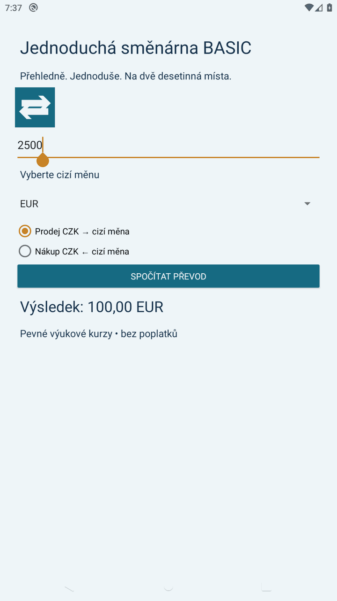
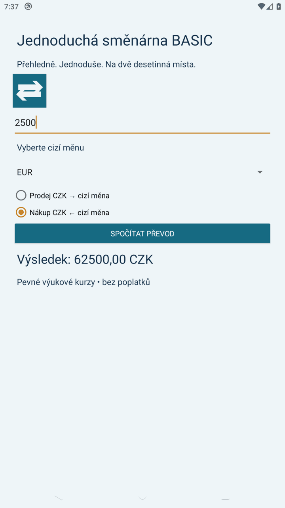
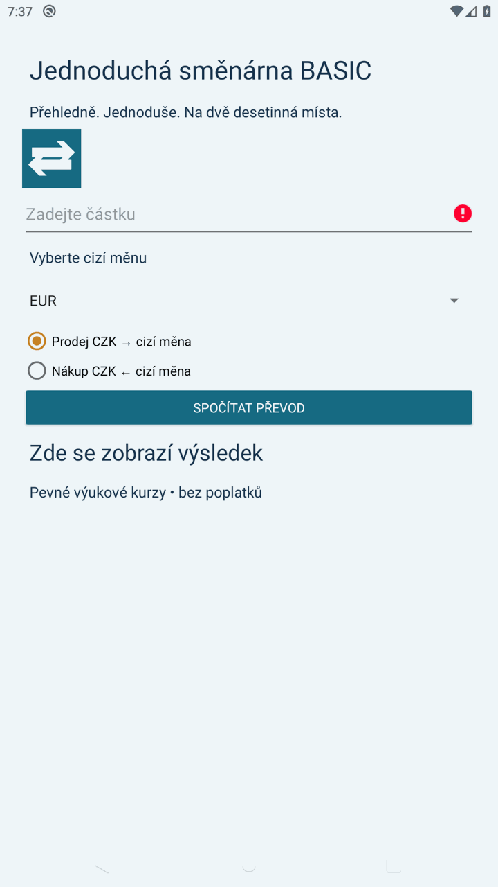

# Dokumentační zpráva — Jednoduchá směnárna BASIC 2.0

Autor: Vojtěch Nováček  
Vývojová větev: 2.x; modul Android Studia: `basic2`.

## Cíl a realizace

Spinner čerpá EUR, USD, GBP a PLN z arrays.xml. RadioGroup určuje vstup v CZK nebo cizí měně. Kurzy za jednotku jsou 25; 23; 29,5; 5,8 CZK.

Všechny popisky, hlášky, názvy a formáty výstupu jsou ve strings.xml. Ikona je vlastní vektorová grafika; BASIC používá modrozelenou, TOP zlatou variantu. Rozhraní používá světlé pozadí a svislé rozložení ve ScrollView.

## Zpracování vstupu a výpočet

Po stisku tlačítka se čte text z EditText. Prázdný vstup se ohlásí pomocí setError. Money.parse sjednotí desetinnou čárku na tečku, ověří formát a převede řetězec pomocí Double.parseDouble. NumberFormatException zachytává MainActivity. Záporné hodnoty, nečíselné hodnoty a přetečení jsou odmítnuty. Money.convert dělí nebo násobí kurzem. Výsledek zobrazuje parametrizovaný zdroj result_currency se dvěma desetinnými místy a kódem měny.

## Životní cyklus

XML prvky mají vlastní ID a Android obnovuje jejich stav. Výsledek se navíc ukládá v onSaveInstanceState.

## Scénáře pro doložení funkčnosti

| Akce | Očekávaný výsledek |
|---|---|
| Nevyplněná částka → převod | Vyplňte částku! |
| Částka 2500, CZK → EUR v BASIC | 100,00 EUR |
| Částka 100, EUR → CZK v BASIC | 2500,00 CZK |
| Částka 12,50 nebo 12.50 | Přijetí stejné desetinné hodnoty |
| Neplatný vstup / přetečení | Chybová hláška, aplikace nespadne |
| Otočení obrazovky po převodu | Zachování vstupu, směru a výsledku |
| Změna měny a směru | Převod podle příslušné měny a směru |

## Ověření sestavení

Dne 21. 10. 2026 byly na GitHub Actions (JDK 17, Android SDK 35) úspěšně provedeny:

- samostatné sestavení debug APK všech tří modulů;
- Android Lint všech tří modulů;
- Java kontroly prázdných/neplatných vstupů, desetinné čárky, obou směrů převodu, přetečení, denního a ročního parseru ČNB i kurzů za více jednotek měny.

Ověřovací běh: https://github.com/novace19/PPM/actions/runs/39563677579

APK jsou v artefaktu `smenarna-apk-and-reports` uvedeného běhu. Testy parseru používají kontrolované vzorky; aktuálnost skutečných síťových dat dokládá až běžící TOP aplikace s datem lístku.

## Printscreeny

### Převod 2500 CZK na 100,00 EUR.

### Opačný směr: 2500 EUR na 62 500,00 CZK.

### Kontrola nevyplněného vstupu pomocí setError.

Snímky byly pořízeny z běžících aplikací na emulátoru Pixel 2 / Android 10 dne 21. 10. 2026. Pro vložení do zprávy byly pouze zmenšeny; nejde o návrhy obrazovek. Celý ověřovací workflow včetně zachycení snímků úspěšně dokončil běh uvedený výše.
