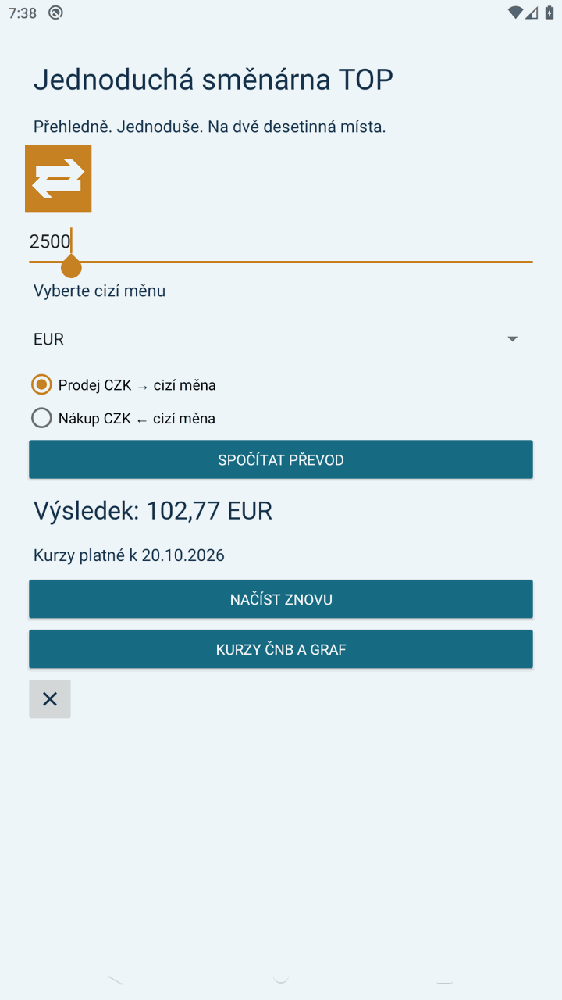
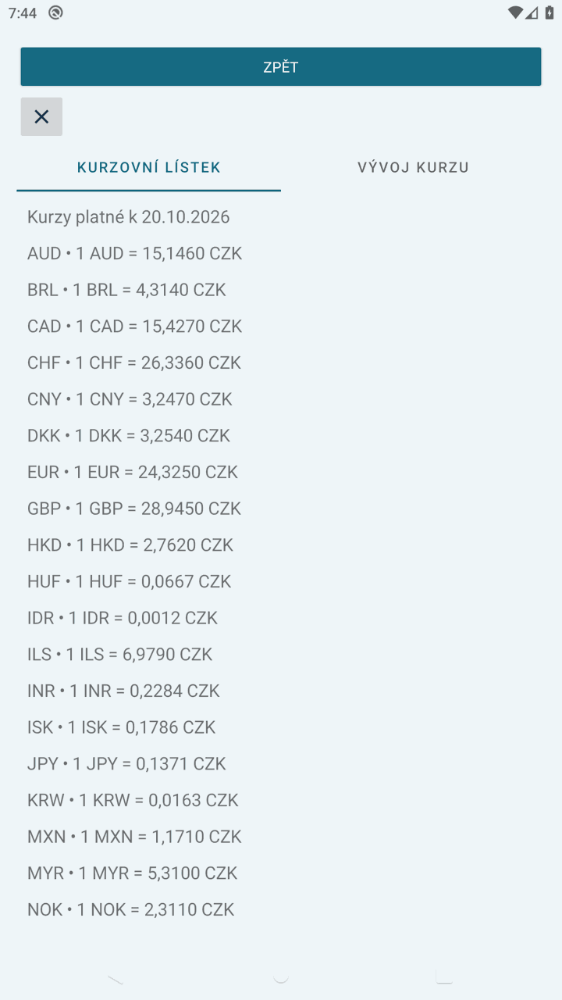
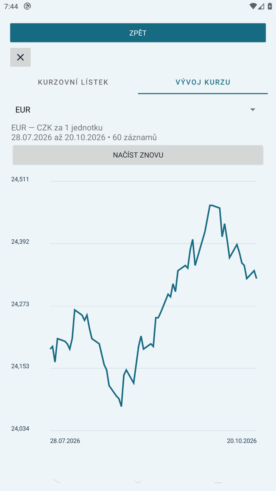

# Dokumentační zpráva — Jednoduchá směnárna TOP 3.0

Autor: Vojtěch Nováček  
Vývojová větev: 3.x; modul Android Studia: `top`.

## Cíl a realizace

Úvodní MainActivity převádí podle skutečně načteného lístku ČNB. RatesActivity obsahuje TabLayout a ViewPager2 se dvěma fragmenty. RatesFragment zobrazuje všechny měny z lístku. ChartFragment umožňuje volbu měny a zobrazuje vlastní Canvas graf s datovými popisky os a skutečnými kalendářními rozestupy. Tlačítko Zpět volá finish(), ImageButton s ikonou křížku volá finishAffinity().

Všechny popisky, hlášky, názvy a formáty výstupu jsou ve strings.xml. Ikona je vlastní vektorová grafika; BASIC používá modrozelenou, TOP zlatou variantu. Rozhraní používá světlé pozadí a svislé rozložení ve ScrollView.

## Zpracování vstupu a výpočet

Po stisku tlačítka se čte text z EditText. Prázdný vstup se ohlásí pomocí setError. Money.parse sjednotí desetinnou čárku na tečku, ověří formát a převede řetězec pomocí Double.parseDouble. NumberFormatException zachytává MainActivity. Záporné hodnoty, nečíselné hodnoty a přetečení jsou odmítnuty. Money.convert dělí nebo násobí kurzem. Výsledek zobrazuje parametrizovaný zdroj result_currency se dvěma desetinnými místy a kódem měny.

## Životní cyklus

XML prvky mají vlastní ID a Android obnovuje jejich stav. Výsledek se navíc ukládá v onSaveInstanceState.

Síťové operace běží v ExecutorService mimo hlavní vlákno, mají connect/read timeout a spojení se uzavírá. ViewModel uchovává načtená data při otočení zařízení. LiveData aktualizuje pouze aktivní pozorovatele; fragmenty používají getViewLifecycleOwner. Pracovní executor se ukončí v onCleared. Při chybě se zobrazí hláška a lze načtení zopakovat; dříve načtený lístek zůstává dostupný a chyba je viditelná. Po ukončení procesu je třeba kurzy znovu načíst. Bez prvního úspěšného načtení je převod zakázán.

Denní parser čte datum, kód, množství a kurz. Výpočet kurz/množství správně zachází i například se 100 JPY. Historický parser hledá sloupec podle měnového kódu, nepředpokládá pevné pořadí sloupců. Graf vynechává nedostupné záznamy, zobrazuje časové rozmezí, počet záznamů a CZK za jednu jednotku. Načítá nejvýše posledních 60 dostupných záznamů.

Zdroj rozhraní: https://www.cnb.cz/cs/casto-kladene-dotazy/Kurzy-devizoveho-trhu-na-www-strankach-CNB/

## Scénáře pro doložení funkčnosti

| Akce | Očekávaný výsledek |
|---|---|
| Nevyplněná částka → převod | Vyplňte částku! |
| Částka 2500, CZK → EUR v BASIC | 100,00 EUR |
| Částka 100, EUR → CZK v BASIC | 2500,00 CZK |
| Částka 12,50 nebo 12.50 | Přijetí stejné desetinné hodnoty |
| Neplatný vstup / přetečení | Chybová hláška, aplikace nespadne |
| Otočení obrazovky po převodu | Zachování vstupu, směru a výsledku |
| Změna měny a směru | Převod podle příslušné měny a směru |
| Odpojení sítě, opakování | Chybová hláška, možnost opakovat |
| Kurzy a graf, přepnutí záložek | Dvě samostatné stránky, historie dle měny |
| Zpět / křížek | Návrat na úvod / ukončení úloh aplikace |

## Ověření sestavení

Dne 21. 10. 2026 byly na GitHub Actions (JDK 17, Android SDK 35) úspěšně provedeny:

- samostatné sestavení debug APK všech tří modulů;
- Android Lint všech tří modulů;
- Java kontroly prázdných/neplatných vstupů, desetinné čárky, obou směrů převodu, přetečení, denního a ročního parseru ČNB i kurzů za více jednotek měny.

Ověřovací běh: https://github.com/novace19/PPM/actions/runs/39563677579

APK jsou v artefaktu `smenarna-apk-and-reports` uvedeného běhu. Testy parseru používají kontrolované vzorky; aktuálnost skutečných síťových dat dokládá až běžící TOP aplikace s datem lístku.

## Printscreeny

### Převod podle načteného kurzu ČNB

Na emulátoru bylo převedeno 2500 CZK na 102,77 EUR podle lístku platného k 20. 10. 2026. Datum označuje platnost lístku, nikoliv datum screenshotu.

### Kurzovní lístek v samostatné aktivitě

Lístek obsahuje všechny měny vrácené denním rozhraním ČNB. Kurzy jsou převedeny na jednu jednotku. V horní části jsou ovládací prvky pro návrat a ukončení.

### Vývoj kurzu ve druhé záložce

Graf zobrazuje 60 zveřejněných záznamů EUR od 28. 7. do 20. 10. 2026. Vodorovná osa představuje datum, svislá CZK za jedno EUR. Nad grafem lze změnit měnu.

Snímky byly pořízeny z běžících aplikací na emulátoru Pixel 2 / Android 10 dne 21. 10. 2026. Pro vložení do zprávy byly pouze zmenšeny; nejde o návrhy obrazovek. Celý ověřovací workflow včetně zachycení snímků úspěšně dokončil běh uvedený výše.
